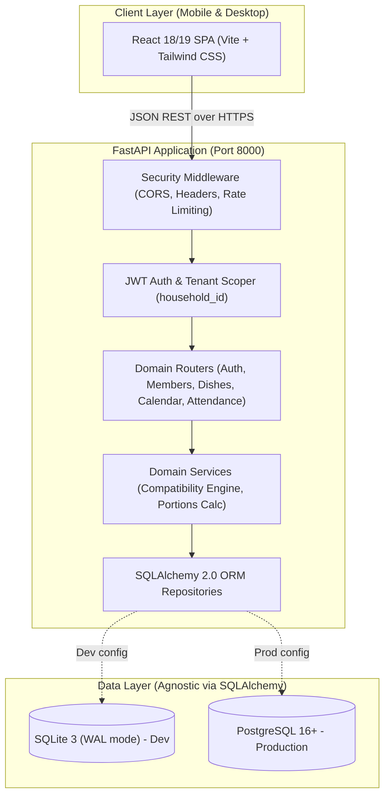
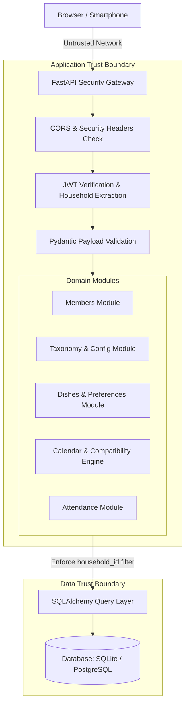

# System Architecture & Module Design (`docs/ARCHITECTURE.md`)
## Project: Menu Design

> **Bottega Profile**: `forge` (MVP / Standard Application / Moderate-Risk)  
> **Status**: Draft for User Sign-Off (Gate 2)  
> **Author**: Bottega System Architect (`system-architect`) in collaboration with DevSecOps (`security-engineer`)

---

## 1. Architecture Overview & Guiding Principles

### 1.1 Architectural Style
Menu Design is architected as a **Decoupled 2-Tier Modular Web Application**:
- **Backend**: Python 3.14 + **FastAPI** providing a high-performance, strictly typed REST API with automatic OpenAPI documentation and Pydantic validation.
- **Frontend**: **React** (TypeScript + Vite + Tailwind CSS) providing a responsive, mobile-first single-page application (SPA) optimized for kitchen counter devices, smartphones, and desktop planning.
- **Database**: Relational storage using **SQLAlchemy 2.0** ORM and **Alembic** migrations, running **SQLite 3 (WAL mode)** during local development and smoothly swapping to **PostgreSQL** in production via environment configuration.



### 1.2 Core Design Principles
1. **Zero-Trust Multi-Tenant Isolation**: Every resource belongs to a `household_id`. The data access layer strictly enforces `household_id` filtering on all operations to eliminate Insecure Direct Object References (IDOR).
2. **Configurability First**: Course types (`Primo`, `Secondo`, etc.), dish statuses (`Da provare`, `OK`, etc.), and recipe sources are managed through lookup entities rather than hardcoded enums.
3. **Optimistic & Resilient UX**: Fast, tactile attendance toggles and meal assignments with clear visual feedback and immediate warning cues when dish dislikes conflict with attendance.
4. **Environment Agnostic Data Layer**: Schema migrations and queries use clean SQLAlchemy abstractions that run identically on SQLite and PostgreSQL.

---

## 2. Technology Stack & Trade-off Decisions

| Layer | Selected Technology | Alternatives Considered | Why Selected (Trade-offs & Security) |
| :--- | :--- | :--- | :--- |
| **Backend Framework** | **FastAPI (Python 3.14)** | Next.js API Routes, Flask, Django | High execution speed, native asynchronous endpoints, automatic Pydantic v2 data validation, and autogenerated OpenAPI documentation. |
| **Frontend Framework** | **React + TypeScript + Vite** | Vue, HTMX, Next.js | Rich interactive ecosystem for drag/drop calendars, instant mobile UI interactions, and strong type sharing with backend contracts. |
| **Styling & Icons** | **Tailwind CSS + Lucide React** | CSS Modules, MUI | Utility-first responsive design tailored for mobile kitchen view; consistent, lightweight modern iconography. |
| **Internationalization (i18n)** | **i18next + react-i18next** | react-intl, LinguiJS | Lightweight, zero backend overhead, instant client-side switching (IT/EN), dynamic locale-aware date formatting via Intl API, persistent via localStorage. |
| **Database & ORM** | **SQLAlchemy 2.0 + Alembic** | Prisma, Tortoise ORM, Raw SQL | Industry-standard Python ORM with full migration support. Perfectly bridges SQLite (development) and PostgreSQL (production). |
| **Database Engines** | **SQLite (Dev) / PostgreSQL (Prod)** | MongoDB, DynamoDB | Relational integrity is mandatory for many-to-many relationships (dishes <-> courses, members <-> dish preferences, calendar slots). |
| **Auth & Security** | **JWT (Bearer / Secure Cookie) + Bcrypt** | Session cookies, NextAuth | Stateless, secure, easily portable between mobile browsers and future native clients; resistant to CSRF when combined with Bearer/SameSite controls. |
| **Testing** | **Pytest + HTTPX** (Backend) & **Vitest** (Frontend) | Jest, Unittest | Extremely fast test runners with fixture support for automated CI test execution. |

---

## 3. System Components & Trust Boundaries



---

## 4. Software Modules & Directory Structure

```text
menu-design-2/
├── backend/
│   ├── app/
│   │   ├── core/
│   │   │   ├── config.py         # Validated Pydantic BaseSettings (DATABASE_URL, SECRET_KEY)
│   │   │   ├── security.py       # Password hashing (bcrypt) and JWT encode/decode
│   │   │   ├── database.py       # SQLAlchemy engine, session maker, base model
│   │   │   └── migrations.py     # Idempotent runtime auto-migrations for SQLite & Postgres
│   │   ├── models/               # SQLAlchemy ORM Models
│   │   │   ├── household.py      # Household & Member models
│   │   │   ├── taxonomy.py       # CourseType, DishStatus, SourceType
│   │   │   ├── dish.py           # Dish, DishCourseType, DishPreference
│   │   │   └── meal_plan.py      # MealSlot, MealSlotDish, MealSlotDishMember, MealSlotDishNote, MealSlotDishRating, Attendance
│   │   ├── schemas/              # Pydantic v2 validation schemas
│   │   │   ├── household.py
│   │   │   ├── member.py
│   │   │   ├── taxonomy.py
│   │   │   ├── dish.py
│   │   │   ├── preference.py
│   │   │   ├── attendance.py
│   │   │   └── meal_plan.py
│   │   ├── routers/              # API Endpoints
│   │   │   ├── auth.py           # Register, login, refresh, me
│   │   │   ├── members.py        # Family member management
│   │   │   ├── taxonomies.py     # Course types, statuses, source types
│   │   │   ├── dishes.py         # CRUD dishes, source bookmarks
│   │   │   ├── preferences.py    # Per-member ratings (favorite, neutral, dislike)
│   │   │   ├── attendance.py     # Daily lunch/dinner attendance
│   │   │   └── calendar.py       # Multi-day meal plan & compatibility checks
│   │   ├── services/             # Business Logic
│   │   │   ├── compatibility.py  # Dislike vs. attendance warning engine
│   │   │   ├── seed_defaults.py  # Seeds default taxonomies on household creation
│   │   │   └── dishes_import_export.py # Excel, CSV & JSON import/export with formula injection defense
│   │   └── main.py               # FastAPI factory, CORS, exception handlers
│   ├── alembic/                  # Alembic DB Migrations
│   ├── tests/                    # Pytest test suite
│   ├── requirements.txt          # Python dependencies
│   └── Dockerfile                # Production non-root container
│
├── frontend/
│   ├── src/
│   │   ├── api/                  # Axios/Fetch typed client
│   │   ├── components/           # Reusable UI widgets
│   │   │   ├── ui/               # Button, Modal, Badge, Input, Card
│   │   │   ├── calendar/         # MealCalendarGrid, MealSlotCard, CompatibilityBadge
│   │   │   ├── dishes/           # DishCard, DishForm, SourceLinkBadge, CourseTag
│   │   │   ├── attendance/       # AttendanceToggleGrid, MemberAvatar
│   │   │   └── preferences/      # PreferenceSelector (favorite / neutral / dislike)
│   │   ├── context/              # AuthContext & ActiveHouseholdContext
│   │   ├── pages/                # Views
│   │   │   ├── DashboardPage.tsx # "Today's Meals" quick kitchen glance
│   │   │   ├── CalendarPage.tsx  # Rolling multi-day planning view
│   │   │   ├── DishesPage.tsx    # Dish catalog & wishlist filter
│   │   │   ├── MembersPage.tsx   # Family members management
│   │   │   └── LoginPage.tsx     # Household login / signup
│   │   ├── types/                # TypeScript interface contracts
│   │   ├── App.tsx
│   │   └── main.tsx
│   ├── package.json
│   ├── tailwind.config.js
│   ├── vite.config.ts
│   └── Dockerfile
│
├── docker-compose.yml            # Local dev / prod orchestration
└── docs/                         # Specifications & Bottega state
```

---

## 5. API Contracts & Key Workflows

All endpoints are prefixed with `/api/v1`. All protected endpoints require a valid `Authorization: Bearer <token>` header.

### 5.1 Authentication & Household
| Endpoint | Method | Auth | Description & Request/Response |
| :--- | :--- | :--- | :--- |
| `/auth/register` | `POST` | None | Registers household: `{ email, password, household_name }` -> `{ token, household }` |
| `/auth/login` | `POST` | None | Authenticates: `{ email, password }` -> `{ token, household }` |
| `/auth/me` | `GET` | Required | Returns current household profile and member list |

### 5.2 Family Members
| Endpoint | Method | Auth | Description |
| :--- | :--- | :--- | :--- |
| `/members` | `GET` | Required | List all members of the household |
| `/members` | `POST` | Required | Add member: `{ name, avatar_color?, is_child?: bool }` |
| `/members/{id}` | `PUT` | Required | Update member profile |
| `/members/{id}` | `DELETE`| Required | Remove member (cascades or soft-deletes references) |

### 5.3 Taxonomies & Configuration Lookups
| Endpoint | Method | Auth | Description |
| :--- | :--- | :--- | :--- |
| `/taxonomies/meal-types` | `GET` | Required | List configurable meal types (`Pranzo`, `Cena`, `Brunch`, `Merenda`, etc.) |
| `/taxonomies/meal-types/{id}` | `DELETE` | Required | Remove meal type and associated slots across range or day if no dishes assigned (`P009`) |
| `/taxonomies/courses` | `GET` | Required | List course types (e.g., Antipasto, Primo, Secondo, etc.) |
| `/taxonomies/courses` | `POST` | Required | Create custom course type |
| `/taxonomies/statuses`| `GET` | Required | List dish statuses backed by lookup table |
| `/taxonomies/sources` | `GET` | Required | List recipe source types (`Libro`, `Sito Web`, `Social`, etc.) |
| `/taxonomies/tags`    | `GET` | Required | List household custom tags |
| `/taxonomies/tags`    | `POST`| Required | Create household custom tag with optional color |
| `/taxonomies/tags/{id}`| `PUT`| Required | Update tag name or color |
| `/taxonomies/tags/{id}`| `DELETE`| Required | Delete tag and cascade remove from dishes |

### 5.4 Dish Catalog & Recipe Sources
| Endpoint | Method | Auth | Description |
| :--- | :--- | :--- | :--- |
| `/dishes` | `GET` | Required | Filterable dish list (query params: `status_id`, `course_id`, `tag_id` with AND logic, `search` substring matching title/notes/tags) |
| `/dishes` | `POST` | Required | Create dish: `{ title, notes?, status_id, course_ids: [1, 2], source: { type_id?, reference?, url? } }`. Rejects duplicate names within household (`LOWER(TRIM(title))`, returns 400). |
| `/dishes/{id}` | `GET` | Required | Get dish details including assigned courses, source info, and member preferences |
| `/dishes/{id}` | `PUT` | Required | Update dish details and assigned courses. Enforces duplicate check if title is renamed. |
| `/dishes/{id}` | `DELETE`| Required | Delete dish |
| `/dishes/{id}/notes` | `GET` | Required | Retrieve historical feedback and notes logged for this dish across past planned meals |
| `/dishes/export` | `GET` | Required | Export filtered dishes to `.xlsx`, `.csv` (UTF-8 BOM), or `.json` (`?format=xlsx\|csv\|json&status_id=&course_id=&search=`) |
| `/dishes/import-template` | `GET` | Required | Download sample template file with canonical English headers (`?format=xlsx\|csv\|json`) |
| `/dishes/import` | `POST` | Required | Multi-part upload (`file`, `mode: skip\|update`) importing dishes into household catalog with validation report |

### 5.5 Member Dish Preferences
| Endpoint | Method | Auth | Description |
| :--- | :--- | :--- | :--- |
| `/dishes/{id}/preferences` | `GET` | Required | Get all member ratings for this dish (defaults to `neutral` if not set) |
| `/dishes/{id}/preferences/{member_id}` | `PUT` | Required | Set rating: `{ rating: 'favorite' \| 'neutral' \| 'dislike' }` |

### 5.6 Attendance & Headcount
| Endpoint | Method | Auth | Description |
| :--- | :--- | :--- | :--- |
| `/attendance` | `GET` | Required | Get attendance matrix for date range or meal slots: `?start_date=2026-10-25&end_date=2026-10-31` |
| `/attendance/{meal_slot_id}` | `PUT` | Required | Update member presence for a specific day's meal: `{ member_id, is_attending: bool }` |

### 5.7 Daily Meal Slots & Compatibility Engine
| Endpoint | Method | Auth | Description |
| :--- | :--- | :--- | :--- |
| `/calendar` | `GET` | Required | Get rolling calendar with planned day slots & compatibility alerts (query params: `start_date`, `end_date`) |
| `/calendar/slots` | `POST` | Required | Create/customize a meal slot for a day: `{ date, meal_type_id, sort_order? }` |
| `/calendar/slots/{id}` | `DELETE`| Required | Remove a meal slot for a day (e.g. eliminate Lunch on Brunch day) |
| `/calendar/slots/{id}/notes` | `PATCH` | Required | Update or clear the general meal slot note (e.g. "Pranzo dalla nonna", `P010`) |
| `/calendar/slots/{id}/dishes` | `POST` | Required | Assign dish to slot: `{ dish_id, sort_order?, notes?, assigned_member_ids?: int[] }` (supports alternative dishes `P002`) |
| `/calendar/slots/{id}/dishes/{dish_id}` | `PATCH` | Required | Update dish assignment in meal slot (e.g. modify assigned diners / alternative dish `Issue #9`): `{ sort_order?, notes?, assigned_member_ids?: int[] }` |
| `/calendar/slots/{id}/dishes/{dish_id}` | `DELETE`| Required | Remove dish from meal slot |
| `/calendar/slots/{id}/dishes/{dish_id}/notes` | `POST` | Required | Add timestamped feedback note to dish consumed in this meal slot |
| `/calendar/slots/{id}/dishes/{dish_id}/notes/{note_id}` | `DELETE` | Required | Delete feedback note from dish consumed in this meal slot |
| `/calendar/slots/{id}/dishes/{dish_id}/ratings` | `POST` | Required | Record member rating for this specific meal (`thumbs_up`, `neutral`, `thumbs_down`, `J001`-`J003`) |
| `/calendar/slots/{id}/dishes/{dish_id}/ratings` | `DELETE` | Required | Clear member rating for this meal |

---

## 6. Security Architecture Baseline (Shift-Left DevSecOps)

### 6.1 Authentication & Token Lifecycle
- Passwords hashed using **Bcrypt** with salt rounds >= 12.
- JWT tokens signed with `HS256` using a cryptographically random `SECRET_KEY` loaded from environment variables (minimum 32 bytes).
- Standard expiration (e.g., 7 days for mobile household convenience) with token revocation support.

### 6.2 Strict Multi-Tenant Authorization (Anti-IDOR)
- **Rule**: No query or mutation is permitted without a `WHERE household_id = :current_household_id` clause.
- A FastAPI dependency `get_current_household` injects the verified household context into all route handlers.

### 6.3 Input Validation & Injection Prevention
- All request payloads strictly parsed and validated using **Pydantic v2**. Extra fields rejected (`extra = "forbid"`).
- All database queries executed via **SQLAlchemy ORM** parameterized queries. Zero raw string concatenation in SQL.
- URLs in recipe sources validated for valid protocols (`http://` or `https://`) to prevent `javascript:` XSS vectors.
- **Spreadsheet / CSV Formula Injection Defense**: All exported cells starting with formula execution characters (`=`, `+`, `-`, `@`, `\t`, `\r`) are sanitized by prepending a single quote `'`. Imported fields are sanitized and file upload size is strictly capped at 5 MB.

### 6.4 Security Headers & CORS
- CORS configured to strictly allow the configured frontend host (e.g. `http://localhost:5173` in dev, specific domain in prod).
- Security headers enforced via middleware:
  - `X-Content-Type-Options: nosniff`
  - `X-Frame-Options: DENY`
  - `Referrer-Policy: strict-origin-when-cross-origin`
  - `Content-Security-Policy`: default-src 'self'

### 6.5 Safe Error Handling
- Global exception handlers catch unhandled exceptions, log the full traceback internally, and return structured JSON error payloads without exposing internal paths or stack traces.

---

## 7. Smart Compatibility Engine Algorithm

The attendance evaluation operates on an **Exception-Based Model**: every household member is assumed **Present by default** unless explicitly flagged as absent for that meal slot.

When scheduling or querying a meal slot:
### 7.1 Compatibility Evaluation Algorithm
```python
def check_meal_compatibility(meal_slot: MealSlot, all_household_members: list[Member], scheduled_dish: Dish) -> CompatibilityResult:
    # 1. Determine attending members (All members minus explicit recorded absences)
    absent_ids = get_recorded_absent_member_ids(meal_slot.id)
    attending_members = [m for m in all_household_members if m.id not in absent_ids]
    attending_member_ids = [m.id for m in attending_members]
    
    # 2. Fetch preferences for scheduled dish
    preferences = get_dish_preferences(scheduled_dish.id)  # member_id -> rating
    
    disliking_present = []
    loving_present = []
    
    for member_id in attending_member_ids:
        # Default rating is 'neutral' if not explicitly set
        rating = preferences.get(member_id, "neutral")
        if rating == "dislike":
            disliking_present.append(member_id)
        elif rating == "favorite":
            loving_present.append(member_id)
            
    if disliking_present:
        return CompatibilityResult(
            status="WARNING",
            message=f"Disliked by attending: {disliking_present}",
            severity="warning"
        )
    elif len(loving_present) == len(attending_member_ids) and attending_member_ids:
        return CompatibilityResult(
            status="HIT",
            message="Loved by all attending members!",
            severity="success"
        )
    else:
        return CompatibilityResult(status="OK", severity="info")
```

### 7.2 Meal Planner Diner Attendance Presentation & Exception UX (Slice S11 / Issue #8)

In the weekly planner (`CalendarView.tsx`), attendance is indicated directly inside meal slots across all three layout modes (`compact_h`, `compact_v`, `detailed`):
- **Concise Cell Indicator**: Placed in the lower-left corner of each cell. Uses a static `Users` icon accompanied by a human-friendly summary:
  - *All Present*: only the `Users` icon is rendered (zero clutter).
  - *Present < Absent*: displays `"solo {names}"` (e.g. `"solo Tizio"`).
  - *Absent $\le$ Present* (with absences): displays `"no {names}"` (e.g. `"no Caio"`).
  - *Zero Present*: displays `"Nessun presente"` / `"Nobody present"`.
- **Constraint Handling**: In compact horizontal and vertical grids, the indicator uses strict CSS truncation (`truncate`, `max-w-[62%]`) so that variable-length family names never deform matrix cell height or width.
- **Attendance Modal & Synchronization**: Clicking the indicator opens an attendance dialog rendering diner pills identical to `TodayView.tsx` (avatar color, active vs. strikethrough absence state with `UserX`). Modifying attendance operates on local state until the user confirms with "Salva", which dispatches individual attendance toggles via `PUT /api/v1/attendance/{slot_id}/members/{member_id}` and re-evaluates calendar slot compatibility alerts in a single refresh.

### 7.3 Responsive Mobile Optimization & Compact Vertical Single-Column Flow (Slice S15 / Issue #13)

To ensure an optimal kitchen dashboard experience on smartphones (360px–430px viewports):
- **Global Viewport Isolation**: Prevent horizontal blowout by setting `overflow-x: hidden; max-width: 100vw;` on `html`, `body`, and `#root`. The main app wrapper (`<main>`) applies `min-w-0` to avoid flex item minimum-content expansion and sets `pb-20 md:pb-4` to clear the fixed mobile bottom navigation bar.
- **Safe Area Insets**: The mobile bottom bar incorporates `pb-[max(0.375rem,env(safe-area-inset-bottom))]` to avoid overlapping the gesture home bar on iOS and Android devices.
- **Adaptive Compact Vertical Flow (`compact_v`)**:
  - Configured as the **system-wide default view mode** (`localStorage: 'compact_v'`).
  - **Desktop (`>= md`)**: Renders a multi-column matrix where days are rows and meal types are side-by-side columns with horizontal table scrolling if needed.
  - **Mobile (`< md`)**: Eliminates horizontal scrolling entirely. When horizontal screen space is insufficient, each day renders a compact day header and an **inline single-column vertical sequence of meal slots** (e.g., Pranzo stacked directly above Cena).
  - Fully shares the unified slot rendering pipeline (`renderCompactSlotBody`), preserving meal note editing, dish removal, alternative dish assignments, attendance pills, and dish quick-creation.
- **Touch-First Control Targets**:
  - Calendar header switches to icon-only buttons on small viewports with tooltip titles, reducing header width footprint.
  - Dish cards expand tap areas (min 36–40px) for edit, delete, expand/collapse toggles, and diner preference rating selectors (`ThumbsUp`, `Meh`, `ThumbsDown`).
  - Catalog actions toolbar renders primary action `+ Nuovo Piatto` with compact icon-first secondary actions (Export count badge, Import icon, Expand/Collapse icon).
