# Database Schema & Data Security Specification (`docs/DB_SCHEMA.md`)
## Project: Menu Design

> **Bottega Profile**: `forge` (MVP / Standard Application / Moderate-Risk)  
> **Status**: Updated Draft for User Sign-Off (Gate 3)  
> **Author**: Bottega Data Architect (`data-architect`)

---

## 1. Storage Engine & Migration Strategy

- **Database Engine**:
  - **Development**: SQLite 3 (WAL mode enabled, foreign keys enforced via PRAGMA `foreign_keys = ON`).
  - **Production**: PostgreSQL 16+ via standard connection string (`DATABASE_URL`).
- **ORM & Migrations**: **SQLAlchemy 2.0** ORM declarative models with **Alembic** for reproducible, agnostic migrations.
- **Tenant Isolation**: Strict column-level scoping (`household_id`) enforced across all application queries and foreign keys.

---

## 2. Entity-Relationship Diagram (Mermaid)

```mermaid
erDiagram
    HOUSEHOLDS ||--o{ MEMBERS : "has"
    HOUSEHOLDS ||--o{ DISHES : "owns"
    HOUSEHOLDS ||--o{ MEAL_SLOTS : "schedules_day_meals"
    HOUSEHOLDS ||--o{ ATTENDANCES : "records"
    
    MEMBERS ||--o{ DISH_MEMBER_PREFERENCES : "rates"
    MEMBERS ||--o{ ATTENDANCES : "participates_in"
    
    DISH_STATUS_LOOKUPS ||--o{ DISH_STATUSES : "defines_lookup"
    DISH_STATUSES ||--o{ DISHES : "classifies"
    SOURCE_TYPES ||--o{ DISHES : "sources"
    
    DISHES ||--o{ DISH_COURSES : "categorized_as"
    COURSE_TYPES ||--o{ DISH_COURSES : "contains"
    
    HOUSEHOLDS ||--o{ TAGS : "owns"
    DISHES ||--o{ DISH_TAGS : "tagged_with"
    TAGS ||--o{ DISH_TAGS : "applied_to"
    
    DISHES ||--o{ DISH_MEMBER_PREFERENCES : "rated_by"
    
    MEAL_TYPES ||--o{ MEAL_SLOTS : "defines_meal_type"
    MEAL_SLOTS ||--o{ MEAL_SLOT_DISHES : "contains_dishes"
    DISHES ||--o{ MEAL_SLOT_DISHES : "scheduled_in"
    
    MEAL_SLOTS ||--o{ ATTENDANCES : "tracks_diner_presence"
    
    MEAL_SLOT_DISHES ||--o{ MEAL_SLOT_DISH_MEMBERS : "targets_members"
    MEMBERS ||--o{ MEAL_SLOT_DISH_MEMBERS : "assigned_to"
    
    MEAL_SLOT_DISHES ||--o{ MEAL_SLOT_DISH_NOTES : "logs_consumption_notes"
    
    MEAL_SLOT_DISHES ||--o{ MEAL_SLOT_DISH_RATINGS : "rated_per_meal"
    MEMBERS ||--o{ MEAL_SLOT_DISH_RATINGS : "rates_meal_dish"

    HOUSEHOLDS {
        int id PK
        string name "NOT NULL"
        string email UK "CONFIDENTIAL_PII"
        string password_hash "SECRET (Bcrypt)"
        timestamp created_at
        timestamp updated_at
    }

    MEMBERS {
        int id PK
        int household_id FK
        string name "NOT NULL"
        string avatar_color
        boolean is_child "DEFAULT false"
        timestamp created_at
        timestamp updated_at
    }

    DISH_STATUS_LOOKUPS {
        int id PK
        string code UK "NOT NULL (to_try, ok, discarded, etc.)"
        string name "NOT NULL (Da provare, OK, Scartato, etc.)"
        string description
        int sort_order "DEFAULT 0"
        boolean is_default "DEFAULT false"
        boolean is_system "DEFAULT true"
    }

    DISH_STATUSES {
        int id PK
        int household_id FK
        int status_lookup_id FK "FK -> dish_status_lookups"
        string custom_label "NULLable override"
        string color
        boolean is_default "DEFAULT false"
        boolean is_active "DEFAULT true"
    }

    MEAL_TYPES {
        int id PK
        string code UK "NOT NULL (lunch, dinner, breakfast, brunch, snack, aperitif)"
        string name "NOT NULL (Pranzo, Cena, Colazione, Brunch, Merenda, Aperitivo)"
        int default_sort_order "NOT NULL"
        boolean is_default_active "DEFAULT false (true for lunch/dinner)"
    }

    COURSE_TYPES {
        int id PK
        int household_id FK "NULLable (default seeds)"
        string name "NOT NULL (Primo, Secondo, etc.)"
        int sort_order "DEFAULT 0"
        boolean is_active "DEFAULT true"
    }

    SOURCE_TYPES {
        int id PK
        int household_id FK "NULLable (default seeds)"
        string name "NOT NULL (Libro, Sito, etc.)"
        string icon
        boolean is_active "DEFAULT true"
    }

    DISHES {
        int id PK
        int household_id FK
        int status_id FK "FK -> dish_statuses(id)"
        int source_type_id FK "NULLable"
        string title "NOT NULL"
        string description
        string notes
        string source_reference
        string source_url
        timestamp created_at
        timestamp updated_at
    }

    DISH_COURSES {
        int dish_id PK,FK
        int course_type_id PK,FK
    }

    TAGS {
        int id PK
        int household_id FK
        string name "NOT NULL"
        string color "DEFAULT #16a34a"
        timestamp created_at
    }

    DISH_TAGS {
        int dish_id PK,FK
        int tag_id PK,FK
    }

    DISH_MEMBER_PREFERENCES {
        int dish_id PK,FK
        int member_id PK,FK
        string rating "CHECK (favorite, neutral, dislike)"
        timestamp updated_at
    }

    MEAL_SLOTS {
        int id PK
        int household_id FK
        date date "NOT NULL"
        int meal_type_id FK "FK -> meal_types(id)"
        int sort_order "DEFAULT 0"
        string notes
        timestamp created_at
        timestamp updated_at
    }

    MEAL_SLOT_DISHES {
        int id PK
        int meal_slot_id FK
        int dish_id FK
        int sort_order "DEFAULT 0"
        string notes
    }

    ATTENDANCES {
        int id PK
        int household_id FK
        int meal_slot_id FK "FK -> meal_slots(id)"
        int member_id FK "FK -> members(id)"
        boolean is_attending "DEFAULT true"
        timestamp updated_at
    }

    MEAL_SLOT_DISH_MEMBERS {
        int meal_slot_dish_id PK,FK "FK -> meal_slot_dishes(id)"
        int member_id PK,FK "FK -> members(id)"
    }

    MEAL_SLOT_DISH_NOTES {
        int id PK
        int meal_slot_dish_id FK "FK -> meal_slot_dishes(id)"
        text note "NOT NULL"
        timestamp created_at
    }

    MEAL_SLOT_DISH_RATINGS {
        int id PK
        int meal_slot_dish_id FK "FK -> meal_slot_dishes(id)"
        int member_id FK "FK -> members(id)"
        string rating "NOT NULL (thumbs_up, neutral, thumbs_down)"
        timestamp created_at
    }
```



---

## 3. Detailed Table Specifications & Constraints

### 3.1 `households`
| Column | Type | Nullable | Default | Constraints | Sensitivity | Description |
| :--- | :--- | :--- | :--- | :--- | :--- | :--- |
| `id` | `INTEGER` | `NO` | Auto-Inc | `PRIMARY KEY` | `INTERNAL` | Unique household identifier |
| `name` | `VARCHAR(100)` | `NO` | - | | `INTERNAL` | Family/household display name |
| `email` | `VARCHAR(255)` | `NO` | - | `UNIQUE` | `CONFIDENTIAL_PII` | Household account login email |
| `password_hash` | `VARCHAR(255)` | `NO` | - | | `SECRET` | Salted Bcrypt password hash |
| `created_at` | `TIMESTAMPTZ` | `NO` | `CURRENT_TIMESTAMP` | | `INTERNAL` | Creation timestamp (UTC) |
| `updated_at` | `TIMESTAMPTZ` | `NO` | `CURRENT_TIMESTAMP` | | `INTERNAL` | Last update timestamp (UTC) |

### 3.2 `members`
| Column | Type | Nullable | Default | Constraints | Sensitivity | Description |
| :--- | :--- | :--- | :--- | :--- | :--- | :--- |
| `id` | `INTEGER` | `NO` | Auto-Inc | `PRIMARY KEY` | `INTERNAL` | Unique member identifier |
| `household_id` | `INTEGER` | `NO` | - | `FOREIGN KEY -> households(id) ON DELETE CASCADE` | `INTERNAL` | Household owner |
| `name` | `VARCHAR(100)` | `NO` | - | `UNIQUE(household_id, name)` | `INTERNAL` | Member display name (e.g. Leo) |
| `avatar_color` | `VARCHAR(20)` | `YES` | `'#3B82F6'` | | `INTERNAL` | Color tag for badges/avatars |
| `is_child` | `BOOLEAN` | `NO` | `FALSE` | | `INTERNAL` | Helps highlight adult-oriented meals |
| `created_at` | `TIMESTAMPTZ` | `NO` | `CURRENT_TIMESTAMP` | | `INTERNAL` | Record creation timestamp |
| `updated_at` | `TIMESTAMPTZ` | `NO` | `CURRENT_TIMESTAMP` | | `INTERNAL` | Last profile update |

### 3.3 Lookup & Taxonomy Tables

#### `dish_status_lookups` (Configurable Master Status Lookup)
- `id`: `INTEGER PRIMARY KEY AUTOINCREMENT`
- `code`: `VARCHAR(50) UNIQUE NOT NULL` (`'to_try'`, `'ok'`, `'discarded'`, `'retry_with_changes'`, `'favorite'`)
- `name`: `VARCHAR(100) NOT NULL` (`'Da provare'`, `'OK'`, `'Scartato'`, `'Da riprovare con variazioni'`, `'Preferito'`)
- `description`: `TEXT NULL`
- `sort_order`: `INTEGER NOT NULL DEFAULT 0`
- `is_default`: `BOOLEAN NOT NULL DEFAULT FALSE` (`TRUE` for `'ok'`)
- `is_system`: `BOOLEAN NOT NULL DEFAULT TRUE`

#### `dish_statuses` (Household Status Configuration)
- `id`: `INTEGER PRIMARY KEY AUTOINCREMENT`
- `household_id`: `INTEGER NOT NULL REFERENCES households(id) ON DELETE CASCADE`
- **`status_lookup_id`**: `INTEGER NOT NULL REFERENCES dish_status_lookups(id) ON DELETE RESTRICT` *(Foreign Key to lookup table)*
- `custom_label`: `VARCHAR(100) NULL` (Optional custom rename)
- `color`: `VARCHAR(20) NOT NULL DEFAULT '#10B981'`
- `is_default`: `BOOLEAN NOT NULL DEFAULT FALSE` (Default status assigned to newly created dishes)
- `is_active`: `BOOLEAN NOT NULL DEFAULT TRUE`
- **Unique Constraint**: `UNIQUE(household_id, status_lookup_id)`

#### `meal_types` (Configurable Daily Meal Types Master Lookup)
- `id`: `INTEGER PRIMARY KEY AUTOINCREMENT`
- `code`: `VARCHAR(30) UNIQUE NOT NULL` (`'lunch'`, `'dinner'`, `'breakfast'`, `'brunch'`, `'snack'`, `'aperitif'`)
- `name`: `VARCHAR(50) NOT NULL` (`'Pranzo'`, `'Cena'`, `'Colazione'`, `'Brunch'`, `'Merenda'`, `'Aperitivo'`)
- `default_sort_order`: `INTEGER NOT NULL` (1: Colazione, 2: Brunch, 3: Pranzo, 4: Merenda, 5: Aperitivo, 6: Cena)
- `is_default_active`: `BOOLEAN NOT NULL DEFAULT FALSE` (Seeded `TRUE` for `'lunch'` and `'dinner'`)

#### `course_types` (Configurable Dish Course Categories)
- `id`: `INTEGER PRIMARY KEY AUTOINCREMENT`
- `household_id`: `INTEGER NULL REFERENCES households(id) ON DELETE CASCADE` (NULL = global seed)
- `name`: `VARCHAR(50) NOT NULL` (`'Antipasto'`, `'Primo'`, `'Secondo'`, `'Contorno'`, `'Piatto unico'`, `'Dolce'`, `'Bevanda'`)
- `sort_order`: `INTEGER NOT NULL DEFAULT 0`
- `is_active`: `BOOLEAN NOT NULL DEFAULT TRUE`

#### `source_types` (Configurable Recipe Source Origins)
- `id`: `INTEGER PRIMARY KEY AUTOINCREMENT`
- `household_id`: `INTEGER NULL REFERENCES households(id) ON DELETE CASCADE`
- `name`: `VARCHAR(50) NOT NULL` (`'Libro / Rivista'`, `'Sito Web'`, `'Social / Reel'`, `'Newsletter'`, `'Note personali'`)
- `icon`: `VARCHAR(50) DEFAULT 'book'`
- `is_active`: `BOOLEAN NOT NULL DEFAULT TRUE`

### 3.4 `dishes`
| Column | Type | Nullable | Default | Constraints | Description |
| :--- | :--- | :--- | :--- | :--- | :--- |
| `id` | `INTEGER` | `NO` | Auto-Inc | `PRIMARY KEY` | Dish identifier |
| `household_id` | `INTEGER` | `NO` | - | `FOREIGN KEY -> households(id) ON DELETE CASCADE` | Tenant scoping |
| `status_id` | `INTEGER` | `NO` | - | `FOREIGN KEY -> dish_statuses(id) ON DELETE RESTRICT` | Status FK |
| `source_type_id` | `INTEGER` | `YES` | - | `FOREIGN KEY -> source_types(id) ON DELETE SET NULL` | Recipe origin type |
| `title` | `VARCHAR(200)` | `NO` | - | | Dish title |
| `description` | `TEXT` | `YES` | - | | Quick description |
| `notes` | `TEXT` | `YES` | - | | Cooking notes / variations |
| `source_reference` | `VARCHAR(255)` | `YES` | - | | Book title, page number, issue |
| `source_url` | `VARCHAR(1000)`| `YES` | - | | Web link or social reel URL |
| `created_at` | `TIMESTAMPTZ` | `NO` | `CURRENT_TIMESTAMP` | | Creation timestamp |
| `updated_at` | `TIMESTAMPTZ` | `NO` | `CURRENT_TIMESTAMP` | | Last update |

### 3.5 `dish_courses` (Many-to-Many Dish <-> Course Types)
| Column | Type | Nullable | Constraints | Description |
| :--- | :--- | :--- | :--- | :--- |
| `dish_id` | `INTEGER` | `NO` | `FOREIGN KEY -> dishes(id) ON DELETE CASCADE` | Dish reference |
| `course_type_id` | `INTEGER` | `NO` | `FOREIGN KEY -> course_types(id) ON DELETE CASCADE` | Course reference |
- **Primary Key**: `(dish_id, course_type_id)`

### 3.6 `tags` (Household Custom Tags)
| Column | Type | Nullable | Default | Constraints | Description |
| :--- | :--- | :--- | :--- | :--- | :--- |
| `id` | `INTEGER` | `NO` | Auto-Inc | `PRIMARY KEY` | Tag identifier |
| `household_id` | `INTEGER` | `NO` | - | `FOREIGN KEY -> households(id) ON DELETE CASCADE` | Tenant scoping |
| `name` | `VARCHAR(50)` | `NO` | - | `UNIQUE(household_id, name)` | Tag name (no commas) |
| `color` | `VARCHAR(20)` | `NO` | `'#16a34a'` | | UI / custom hex color |
| `created_at` | `TIMESTAMPTZ` | `NO` | `CURRENT_TIMESTAMP` | | Creation timestamp |

### 3.7 `dish_tags` (Many-to-Many Dish <-> Tags)
| Column | Type | Nullable | Constraints | Description |
| :--- | :--- | :--- | :--- | :--- |
| `dish_id` | `INTEGER` | `NO` | `FOREIGN KEY -> dishes(id) ON DELETE CASCADE` | Dish reference |
| `tag_id` | `INTEGER` | `NO` | `FOREIGN KEY -> tags(id) ON DELETE CASCADE` | Tag reference |
- **Primary Key**: `(dish_id, tag_id)`

### 3.8 `dish_member_preferences` (Member Preferences)
| Column | Type | Nullable | Default | Constraints | Description |
| :--- | :--- | :--- | :--- | :--- | :--- |
| `dish_id` | `INTEGER` | `NO` | - | `FOREIGN KEY -> dishes(id) ON DELETE CASCADE` | Rated dish |
| `member_id` | `INTEGER` | `NO` | - | `FOREIGN KEY -> members(id) ON DELETE CASCADE` | Rating family member |
| `rating` | `VARCHAR(20)` | `NO` | `'neutral'` | `CHECK (rating IN ('favorite', 'neutral', 'dislike'))` | Preference value |
| `updated_at` | `TIMESTAMPTZ` | `NO` | `CURRENT_TIMESTAMP` | | When rating was last adjusted |
- **Primary Key**: `(dish_id, member_id)`

### 3.7 `meal_slots` (Dynamic Daily Meal Plan & Slots)
*Represents the specific meals scheduled on a date for a household (default: Pranzo and Cena; customizable per day, e.g. adding Brunch or Merenda, or removing Lunch).*

| Column | Type | Nullable | Default | Constraints | Description |
| :--- | :--- | :--- | :--- | :--- | :--- |
| `id` | `INTEGER` | `NO` | Auto-Inc | `PRIMARY KEY` | Slot ID |
| `household_id` | `INTEGER` | `NO` | - | `FOREIGN KEY -> households(id) ON DELETE CASCADE` | Household scoping |
| `date` | `DATE` | `NO` | - | | Scheduled date (YYYY-MM-DD) |
| **`meal_type_id`** | `INTEGER` | `NO` | - | `FOREIGN KEY -> meal_types(id) ON DELETE RESTRICT` | **FK to configurable meal type** |
| `sort_order` | `INTEGER` | `NO` | `0` | | Display order in day |
| `notes` | `TEXT` | `YES` | - | | Freeform meal notes |
| `created_at` | `TIMESTAMPTZ` | `NO` | `CURRENT_TIMESTAMP` | | Slot creation |
| `updated_at` | `TIMESTAMPTZ` | `NO` | `CURRENT_TIMESTAMP` | | Last modification |
- **Unique Constraint**: `UNIQUE(household_id, date, meal_type_id)`

### 3.8 `meal_slot_dishes`
| Column | Type | Nullable | Default | Constraints | Description |
| :--- | :--- | :--- | :--- | :--- | :--- |
| `id` | `INTEGER` | `NO` | Auto-Inc | `PRIMARY KEY` | Assignment ID |
| `meal_slot_id` | `INTEGER` | `NO` | - | `FOREIGN KEY -> meal_slots(id) ON DELETE CASCADE` | Meal slot |
| `dish_id` | `INTEGER` | `NO` | - | `FOREIGN KEY -> dishes(id) ON DELETE CASCADE` | Scheduled dish |
| `sort_order` | `INTEGER` | `NO` | `0` | | Serving order (1=Primo, 2=Secondo) |
| `notes` | `VARCHAR(255)` | `YES` | - | | Special instruction / alternative |
- **Unique Constraint**: `UNIQUE(meal_slot_id, dish_id)`

### 3.9 `attendances` (Exception-Based Diner Attendance per Planned Meal Slot)
*Operates on an **Exception-Based Model**: every member of the household is considered **Present by default** for every scheduled meal slot unless explicitly marked absent (`is_attending = FALSE`).*

| Column | Type | Nullable | Default | Constraints | Description |
| :--- | :--- | :--- | :--- | :--- | :--- |
| `id` | `INTEGER` | `NO` | Auto-Inc | `PRIMARY KEY` | Attendance record ID |
| `household_id` | `INTEGER` | `NO` | - | `FOREIGN KEY -> households(id) ON DELETE CASCADE` | Tenant scoping |
| **`meal_slot_id`** | `INTEGER` | `NO` | - | `FOREIGN KEY -> meal_slots(id) ON DELETE CASCADE` | **FK to specific day's meal slot** |
| `member_id` | `INTEGER` | `NO` | - | `FOREIGN KEY -> members(id) ON DELETE CASCADE` | Attending member |
| `is_attending` | `BOOLEAN` | `NO` | `FALSE` | | `FALSE` indicates recorded absence (exception) |
| `updated_at` | `TIMESTAMPTZ` | `NO` | `CURRENT_TIMESTAMP` | | Timestamp of toggle |
- **Unique Constraint**: `UNIQUE(meal_slot_id, member_id)`
- **Evaluation Rule**:
  ```python
  # Given a meal slot and household members:
  # Any member without an explicit 'is_attending = False' record is PRESENT.
  def get_attending_members(meal_slot_id: int, all_household_members: list[Member]) -> list[Member]:
      absent_member_ids = {
          att.member_id for att in db.query(Attendance)
          .filter_by(meal_slot_id=meal_slot_id, is_attending=False)
      }
      return [m for m in all_household_members if m.id not in absent_member_ids]
  ```

### 3.10 `meal_slot_dish_members` (Alternative Dishes & Member Targeting)
*Enables assigning a dish in a meal slot to specific household members (P002: alternative dishes, e.g. Pasta al burro for Leo while parents have Risotto).*

| Column | Type | Nullable | Default | Constraints | Description |
| :--- | :--- | :--- | :--- | :--- | :--- |
| `meal_slot_dish_id` | `INTEGER` | `NO` | - | `PRIMARY KEY, FOREIGN KEY -> meal_slot_dishes(id) ON DELETE CASCADE` | Assigned meal slot dish |
| `member_id` | `INTEGER` | `NO` | - | `PRIMARY KEY, FOREIGN KEY -> members(id) ON DELETE CASCADE` | Specific targeted family diner |
- **Primary Key**: `(meal_slot_dish_id, member_id)`

### 3.11 `meal_slot_dish_notes` (Dish Consumption Feedback History)
*Enables recording multiple timestamped notes and feedback entries each time a dish is cooked and consumed.*

| Column | Type | Nullable | Default | Constraints | Description |
| :--- | :--- | :--- | :--- | :--- | :--- |
| `id` | `INTEGER` | `NO` | Auto-Inc | `PRIMARY KEY` | Note ID |
| `meal_slot_dish_id` | `INTEGER` | `NO` | - | `FOREIGN KEY -> meal_slot_dishes(id) ON DELETE CASCADE` | Meal slot dish assignment |
| `note` | `TEXT` | `NO` | - | | Preparation feedback or consumption comment |
| `created_at` | `TIMESTAMPTZ` | `NO` | `CURRENT_TIMESTAMP` | | Timestamp of entry |

### 3.12 `meal_slot_dish_ratings` (Per-Meal Diner Dish Rating)
*Records whether a dish was enjoyed during a specific meal slot (J001-J003), completely independent from the member's permanent preference in `dish_member_preferences` (e.g. "pasta was overcooked today, didn't enjoy it today, but I still love pasta overall").*

| Column | Type | Nullable | Default | Constraints | Description |
| :--- | :--- | :--- | :--- | :--- | :--- |
| `id` | `INTEGER` | `NO` | Auto-Inc | `PRIMARY KEY` | Rating ID |
| `meal_slot_dish_id` | `INTEGER` | `NO` | - | `FOREIGN KEY -> meal_slot_dishes(id) ON DELETE CASCADE` | Meal slot dish assignment |
| `member_id` | `INTEGER` | `NO` | - | `FOREIGN KEY -> members(id) ON DELETE CASCADE` | Rating family member |
| `rating` | `VARCHAR(20)` | `NO` | - | `CHECK (rating IN ('thumbs_up', 'neutral', 'thumbs_down'))` | Per-meal enjoyment rating |
| `created_at` | `TIMESTAMPTZ` | `NO` | `CURRENT_TIMESTAMP` | | Timestamp of rating |
- **Unique Constraint**: `UNIQUE(meal_slot_dish_id, member_id)`

---

## 4. Indexing Strategy & Query Performance

| Index Name | Table & Columns | Target Access Pattern |
| :--- | :--- | :--- |
| `idx_households_email` | `households(email)` | Fast O(1) login lookup |
| `idx_members_household` | `members(household_id)` | List household members |
| `idx_dish_statuses_household` | `dish_statuses(household_id, status_lookup_id)` | Household status lookups |
| `idx_dishes_household_status` | `dishes(household_id, status_id)` | Fast catalog filtering by status |
| `idx_dish_courses_course` | `dish_courses(course_type_id, dish_id)` | Filter catalog by course (e.g. only Primi) |
| `idx_dish_preferences_dish` | `dish_member_preferences(dish_id)` | Instant retrieval of all ratings for a dish |
| `idx_meal_slots_date_range` | `meal_slots(household_id, date, meal_type_id)` | Rolling calendar query for date window |
| `idx_attendances_slot` | `attendances(meal_slot_id, is_attending)` | Real-time headcount and present members for a meal |
| `idx_slot_dish_notes_slot` | `meal_slot_dish_notes(meal_slot_dish_id)` | Retrieve feedback notes for slot dish |
| `idx_slot_dish_ratings_slot` | `meal_slot_dish_ratings(meal_slot_dish_id, member_id)` | Query per-meal ratings for members |

---

## 5. Data Security, Privacy & Seeding Strategy

### 5.1 Seeding Strategy (Default Master Lookups)

1. **`dish_status_lookups` Seed**:
   - `to_try` -> `'Da provare'`, sort: 1
   - `ok` -> `'OK'`, sort: 2
   - `discarded` -> `'Scartato'`, sort: 3
   - `retry_with_changes` -> `'Da riprovare con variazioni'`, sort: 4
   - `favorite` -> `'Preferito'`, sort: 5

2. **`meal_types` Seed**:
   - `breakfast` -> `'Colazione'`, sort: 1, `is_default_active`: false
   - `brunch` -> `'Brunch'`, sort: 2, `is_default_active`: false
   - `lunch` -> `'Pranzo'`, sort: 3, `is_default_active`: true
   - `snack` -> `'Merenda'`, sort: 4, `is_default_active`: false
   - `aperitif` -> `'Aperitivo'`, sort: 5, `is_default_active`: false
   - `dinner` -> `'Cena'`, sort: 6, `is_default_active`: true

3. **`course_types` Seed**:
   - `Antipasto`, `Primo`, `Secondo`, `Contorno`, `Piatto unico`, `Dolce`, `Bevanda`

4. **`source_types` Seed**:
   - `Libro / Rivista`, `Sito Web`, `Social / Reel`, `Newsletter`, `Note personali`
