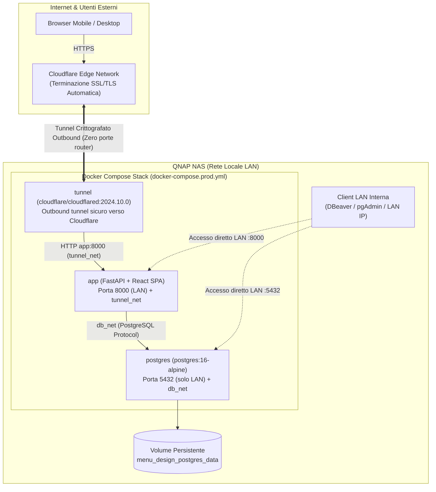

# Production Deployment Runbook: QNAP NAS + Docker Hub + Cloudflare Tunnel

> **Target Environment**: QNAP NAS (Container Station / Docker Compose over SSH)  
> **Image Registry**: Docker Hub (`<username>/menu-design-app:<tag>`)  
> **Ingress & TLS**: Cloudflare Zero Trust Tunnel (`cloudflared` container, zero open router ports)  
> **Database**: PostgreSQL 16 Alpine with Docker named volume (`menu_design_postgres_data`) + LAN access  

---

## 1. Architettura di Deployment



### Caratteristiche Chiave di Sicurezza e Architettura:
1. **Zero Porte Aperte sul Router**: Non è necessario alcun Port Forwarding su router domestico/aziendale. Cloudflare Tunnel instaura una connessione crittografata outbound verso i server Cloudflare.
2. **PostgreSQL Isolato ma Raggiungibile in LAN**: Il database comunica direttamente con l'applicazione su una rete bridge dedicata (`db_net`). La porta `5432` è esposta sull'interfaccia host del QNAP solo per l'accesso da client interni della LAN (DBeaver, pgAdmin), restando completamente invisibile a internet.
3. **Container Non-Root**: L'immagine applicativa esegue con un utente Linux non privilegiato (`appuser:appgroup`, UID 10001).
4. **Build Leggera e Distribuita via Docker Hub**: Il NAS non esegue compilazioni Node/Python; riceve l'immagine già compilata e pronta da Docker Hub.
5. **Persistenza Garantita**: I dati di PostgreSQL risiedono in un volume Docker nativo (`menu_design_postgres_data`) allocato nello storage pool del QNAP.

---

## 2. Prerequisiti

1. **Stazione di Sviluppo (PC locale)**:
   - Docker installato con supporto `buildx` (o standard `docker build`).
   - Account attivo su [Docker Hub](https://hub.docker.com).
2. **NAS QNAP**:
   - **Container Station** installata e aggiornata dall'App Center QNAP.
   - Accesso SSH abilitato (Pannello di controllo QNAP -> Servizi di rete e file -> Telnet/SSH).
   - Indirizzo IP del QNAP fisso o riservato tramite DHCP (es. `192.168.1.100`).
3. **Cloudflare Zero Trust**:
   - Account Cloudflare con il tuo dominio (es. `tuodominio.com`).
   - Zero Trust Dashboard -> **Networks** -> **Tunnels** -> Crea un Tunnel (tipo `Cloudflared`) e copia il **Tunnel Token**.

---

## 3. Guida Passo-Passo al Deployment

### Fase 1: Build e Push dell'Immagine su Docker Hub (da PC locale)

Dalla cartella principale del progetto sul tuo PC di sviluppo:

1. Effettua il login su Docker Hub:
   ```bash
   docker login
   ```

2. Esegui lo script di build e push specificando il tuo username Docker Hub (e un tag opzionale, es. `v1.0.0` o `latest`):
   ```bash
   ./scripts/build_and_push_dockerhub.sh <tuo-username-dockerhub> latest
   ```
   *Nota: Lo script crea automaticamente un'immagine multi-architettura (`linux/amd64` e `linux/arm64`) compatibile con qualsiasi processore QNAP.*

---

### Fase 2: Configurazione della Cartella sul QNAP

Accedi via SSH al QNAP (o usa File Station di QNAP):

1. Connettiti in SSH:
   ```bash
   ssh admin@<IP_DEL_QNAP>
   ```

2. Crea la cartella per l'applicazione (ad esempio nello share `Container` del QNAP):
   ```bash
   mkdir -p /share/Container/menu-design
   cd /share/Container/menu-design
   ```

3. Copia sul QNAP i file necessari:
   - `docker-compose.prod.yml`
   - `.env.production.example` (da rinominare in `.env.production`)

   *Puoi trasferirli tramite SCP, SFTP, o creandoli direttamente sul QNAP con un editor di testo (`nano` / `vi`).*

4. Crea il file `.env.production`:
   ```bash
   cp .env.production.example .env.production
   chmod 600 .env.production
   nano .env.production
   ```

---

### Fase 3: Configurazione delle Variabili d'Ambiente (`.env.production`)

Compila i seguenti parametri in `/share/Container/menu-design/.env.production`:

```dotenv
# Nome dell'immagine caricata su Docker Hub
APP_IMAGE=<tuo-username-dockerhub>/menu-design-app:latest

# Porte sul QNAP (accessibili in LAN)
APP_PORT_MAPPING=8000:8000
POSTGRES_PORT_MAPPING=5432:5432

# Chiave di sicurezza JWT (genera una stringa sicura di almeno 32 caratteri)
# Comando per generarla sul PC: openssl rand -hex 32
SECRET_KEY=sostituisci_con_chiave_casuale_segreta_minimo_32_caratteri!

# Domini autorizzati per CORS (LAN + Dominio pubblico del Tunnel)
CORS_ORIGINS=http://localhost:8000,http://<IP_DEL_QNAP>:8000,https://menu.tuodominio.com

# Credenziali PostgreSQL per il container
POSTGRES_DB=menu_design
POSTGRES_USER=menu_user
POSTGRES_PASSWORD=una_password_forte_per_il_database_su_qnap!

# Token Cloudflare Zero Trust (ottenuto da Cloudflare Dashboard)
TUNNEL_TOKEN=eyJhIjoi...il_tuo_token_cloudflare_completo...
```

---

### Fase 4: Avvio dello Stack su QNAP

Dalla cartella `/share/Container/menu-design/`:

```bash
docker compose -f docker-compose.prod.yml --env-file .env.production up -d
```

> **Alternativa da Container Station UI (Web GUI)**:
> Se preferisci usare l'interfaccia grafica di QNAP:
> 1. Apri **Container Station** -> **Applicazioni** -> **Crea**.
> 2. Assegna il nome `menu-design`.
> 3. Incolla il contenuto di `docker-compose.prod.yml`.
> 4. Nella sezione variabili d'ambiente, aggiungi le variabili configurate in `.env.production`.
> 5. Clicca su **Crea**.

---

### Fase 5: Configurazione dell'Hostname Pubblico su Cloudflare

Nella dashboard **Cloudflare Zero Trust**:
1. Vai su **Networks** -> **Tunnels** e seleziona il tunnel avviato sul QNAP (lo stato risulterà `HEALTHY`).
2. Vai nella scheda **Public Hostname** e clicca su **Add a public hostname**.
3. Configura:
   - **Subdomain**: `menu`
   - **Domain**: `tuodominio.com`
   - **Path**: *(lascia vuoto)*
   - **Service Type**: `HTTP`
   - **URL**: `app:8000` *(poiché il container tunnel si trova sulla stessa rete Docker `tunnel_net` del container `app`)*
4. Salva la configurazione.

---

## 4. Verifica e Collaudo

1. **Verifica stato container**:
   ```bash
   docker compose -f docker-compose.prod.yml ps
   ```
   *Output atteso:*
   ```text
   NAME                   IMAGE                                STATUS                    PORTS
   menu-design-app        myuser/menu-design-app:latest        Up (healthy)              0.0.0.0:8000->8000/tcp
   menu-design-postgres   postgres:16-alpine                   Up (healthy)              0.0.0.0:5432->5432/tcp
   menu-design-tunnel     cloudflare/cloudflared:2024.10.0     Up                        
   ```

2. **Test di Healthcheck HTTP**:
   ```bash
   # Usa -i (minuscolo per GET con header) oppure curl semplice:
   curl -i http://localhost:8000/health
   # Risposta: HTTP/1.1 200 OK {"status":"ok","app":"Menu Design API","version":"1.0.0"}
   ```

3. **Test di connessione esterna tramite Cloudflare**:
   Accedi da smartphone (rete 4G/5G) o browser esterno su:
   `https://menu.tuodominio.com`
   - Verifica che l'interfaccia React SPA si carichi istantaneamente.
   - Effettua il login o crea il primo nucleo familiare.

4. **Test di connessione PostgreSQL da LAN**:
   Da DBeaver / pgAdmin su un computer nella stessa rete locale del QNAP:
   - Host: `<IP_DEL_QNAP>`
   - Port: `5432`
   - Database: `menu_design`
   - User: `menu_user`
   - Password: `<POSTGRES_PASSWORD>`

---

## 5. Operazioni e Manutenzione (Day-2 Operations)

### Aggiornamento dell'Applicazione con Nuova Release

Quando rilasci una nuova versione del codice:
1. Sul tuo PC di sviluppo, compila e pubblica la nuova versione:
   ```bash
   ./scripts/build_and_push_dockerhub.sh <tuo-username-dockerhub> latest
   ```
2. Sul QNAP via SSH:
   ```bash
   cd /share/Container/menu-design
   docker compose -f docker-compose.prod.yml pull app
   docker compose -f docker-compose.prod.yml --env-file .env.production up -d app
   ```

### Consultazione dei Log
```bash
# Log in streaming dell'applicazione
docker compose -f docker-compose.prod.yml logs -f app

# Log del database PostgreSQL
docker compose -f docker-compose.prod.yml logs -f postgres

# Log del tunnel Cloudflare
docker compose -f docker-compose.prod.yml logs -f tunnel
```

### Backup del Database PostgreSQL
Per eseguire un dump sicuro del database sul QNAP:
```bash
docker compose -f docker-compose.prod.yml exec -t postgres pg_dump -U menu_user menu_design > /share/Container/menu-design/backup_$(date +%Y%m%d_%H%M%S).sql
```

Per eseguire il backup schedulato, farlo da utente admin e inserire nel suo crontab una riga come questa
```bash
0 3 * * * cd /share/CACHEDEV1_DATA/Container/menu-design && /share/CACHEDEV1_DATA/.qpkg/container-station/bin/docker compose -f docker-compose.prod.yml exec -t postgres pg_dump -U menu_user menu_design > /share/Container/menu-design/db_backup/backup_$(date +%Y%m%d_%H%M%S).sql
```


### Riavvio o Stop dello Stack
```bash
# Riavvia l'intero stack
docker compose -f docker-compose.prod.yml restart

# Ferma lo stack preservando tutti i volumi dati
docker compose -f docker-compose.prod.yml down
```
