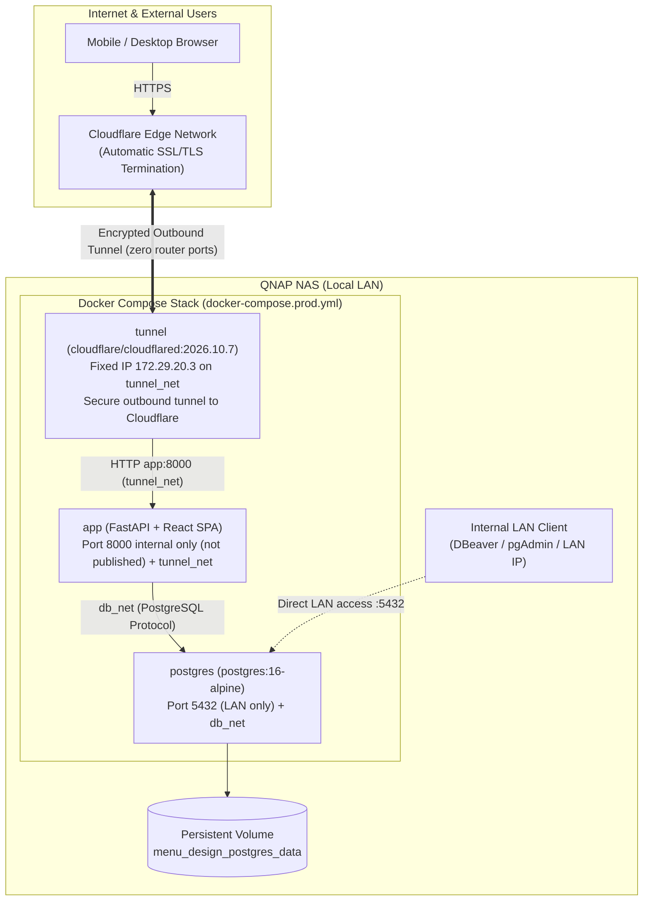

# Production Deployment Runbook: QNAP NAS + Docker Hub + Cloudflare Tunnel

> **Target Environment**: QNAP NAS (Container Station / Docker Compose over SSH)  
> **Image Registry**: Docker Hub (`<username>/menu-design-app:<tag>`)  
> **Ingress & TLS**: Cloudflare Zero Trust Tunnel (`cloudflared` container, zero open router ports)  
> **Database**: PostgreSQL 16 Alpine with Docker named volume (`menu_design_postgres_data`) + LAN access  

---

## 1. Deployment Architecture



### Key Security and Architecture Features:
1. **Zero open router ports**: No port forwarding is needed on a home/corporate router. Cloudflare Tunnel establishes an encrypted outbound connection to Cloudflare's servers.
2. **PostgreSQL isolated but reachable on the LAN**: The database talks to the application directly over a dedicated bridge network (`db_net`). Port `5432` is exposed on the QNAP host interface only for access from internal LAN clients (DBeaver, pgAdmin), and stays completely invisible from the internet.
3. **Non-root container**: The application image runs as an unprivileged Linux user (`appuser:appgroup`, UID 10001).
4. **Lightweight build distributed via Docker Hub**: The NAS does not run Node/Python builds; it receives the already-built image from Docker Hub.
5. **Guaranteed persistence**: PostgreSQL data lives in a native Docker volume (`menu_design_postgres_data`) allocated in the QNAP storage pool.

---

## 2. Prerequisites

1. **Development workstation (local PC)**:
   - Docker installed with `buildx` support (or standard `docker build`).
   - An active [Docker Hub](https://hub.docker.com) account.
2. **QNAP NAS**:
   - **Container Station** installed and up to date from the QNAP App Center.
   - SSH access enabled (QNAP Control Panel -> Network & File Services -> Telnet/SSH).
   - Fixed QNAP IP address, or one reserved via DHCP (e.g. `192.168.1.100`).
3. **Cloudflare Zero Trust**:
   - A Cloudflare account with your domain (e.g. `yourdomain.com`).
   - Zero Trust Dashboard -> **Networks** -> **Tunnels** -> create a Tunnel (type `Cloudflared`) and copy the **Tunnel Token**.

---

## 3. Step-by-Step Deployment Guide

### Phase 1: Build and Push the Image to Docker Hub (from the local PC)

From the project root folder on your development PC:

1. Log in to Docker Hub:
   ```bash
   docker login
   ```

2. Run the build-and-push script, specifying your Docker Hub username (and an optional tag, e.g. `v1.0.0` or `latest`):
   ```bash
   ./scripts/build_and_push_dockerhub.sh <your-dockerhub-username> latest
   ```
   *Note: the script automatically creates a multi-architecture image (`linux/amd64` and `linux/arm64`) compatible with any QNAP processor.*

---

### Phase 2: Set Up the Folder on the QNAP

Log in to the QNAP via SSH (or use QNAP File Station):

1. Connect via SSH:
   ```bash
   ssh admin@<QNAP_IP>
   ```

2. Create the application folder (for example in the QNAP `Container` share):
   ```bash
   mkdir -p /share/Container/menu-design
   cd /share/Container/menu-design
   ```

3. Copy the required files to the QNAP:
   - `docker-compose.prod.yml.example` (to be renamed `docker-compose.prod.yml`; the real file is ignored by git)
   - `.env.production.example` (to be renamed `.env.production`)

   *You can transfer them via SCP, SFTP, or by creating them directly on the QNAP with a text editor (`nano` / `vi`).*

4. Create the `.env.production` file:
   ```bash
   cp .env.production.example .env.production
   chmod 600 .env.production
   nano .env.production
   ```

---

### Phase 3: Configure the Environment Variables (`.env.production`)

Fill in the following parameters in `/share/Container/menu-design/.env.production`:

```dotenv
# Name of the image uploaded to Docker Hub
APP_IMAGE=<your-dockerhub-username>/menu-design-app:latest

# PostgreSQL port on the QNAP (reachable from the LAN)
# The app's port 8000 is NOT published on the host: the app is reachable only via Cloudflare Tunnel
POSTGRES_PORT_MAPPING=5432:5432

# JWT signing key (generate a secure string of at least 32 characters)
# Command to generate it on the PC: openssl rand -hex 32
SECRET_KEY=replace_with_a_random_secret_key_at_least_32_characters!

# Allowed CORS origins (public domain of the Tunnel)
CORS_ORIGINS=http://localhost:8000,https://menu.yourdomain.com

# PostgreSQL credentials for the container
POSTGRES_DB=menu_design
POSTGRES_USER=menu_user
POSTGRES_PASSWORD=a_strong_database_password_on_qnap!

# Login/registration rate limiting (requests per minute per IP)
AUTH_RATE_LIMIT_PER_MINUTE=10

# IP of the cloudflared container ONLY, as a /32 (never the whole Docker subnet).
# Must match `ipv4_address` of the `tunnel` service in the compose file (see below).
TRUSTED_PROXY_IPS=172.29.20.3/32

# Cloudflare Zero Trust token (obtained from the Cloudflare Dashboard)
TUNNEL_TOKEN=eyJhIjoi...your_full_cloudflare_token...
```

---

### Phase 3b: Fixed Tunnel IP and `TRUSTED_PROXY_IPS`

Behind the tunnel all requests come from the `cloudflared` container: without `TRUSTED_PROXY_IPS` all users share the same rate-limit counter. The value must be the IP of the `cloudflared` container only, with `/32`, and it must be pinned in the compose file so it does not change on restart:

1. If the network already exists, read its name and subnet (the name is `<folder>_tunnel_net`):
   ```bash
   docker inspect -f '{{range $n, $net := .NetworkSettings.Networks}}{{$n}} {{$net.IPAddress}}{{"\n"}}{{end}}' menu-design-tunnel
   docker network inspect <network_name> -f '{{range .IPAM.Config}}{{.Subnet}} {{.Gateway}}{{end}}'
   ```
2. In `docker-compose.prod.yml` set `ipv4_address` of the `tunnel` service (a free IP inside the subnet) and declare the same subnet/gateway in `networks.tunnel_net.ipam`. If the network already exists the subnet must match **exactly** (e.g. `/22`, not `/24`), otherwise Docker reports a conflict and a `down` (without `-v`) is needed before the new `up`.
3. Set `TRUSTED_PROXY_IPS=<ipv4_address>/32` in `.env.production`.

---

### Phase 4: Start the Stack on the QNAP

From the `/share/Container/menu-design/` folder:

```bash
docker compose -f docker-compose.prod.yml --env-file .env.production up -d
```

> **Alternative from the Container Station UI (Web GUI)**:
> If you prefer to use the QNAP graphical interface:
> 1. Open **Container Station** -> **Applications** -> **Create**.
> 2. Name it `menu-design`.
> 3. Paste the contents of `docker-compose.prod.yml`.
> 4. In the environment variables section, add the variables configured in `.env.production`.
> 5. Click **Create**.

---

### Phase 5: Configure the Public Hostname on Cloudflare

In the **Cloudflare Zero Trust** dashboard:
1. Go to **Networks** -> **Tunnels** and select the tunnel started on the QNAP (its status will be `HEALTHY`).
2. Open the **Public Hostname** tab and click **Add a public hostname**.
3. Configure:
   - **Subdomain**: `menu`
   - **Domain**: `yourdomain.com`
   - **Path**: *(leave empty)*
   - **Service Type**: `HTTP`
   - **URL**: `app:8000` *(because the tunnel container is on the same `tunnel_net` Docker network as the `app` container)*
4. Save the configuration.

---

## 4. Verification and Acceptance Testing

1. **Check container status**:
   ```bash
   docker compose -f docker-compose.prod.yml ps
   ```
   *Expected output:*
   ```text
   NAME                   IMAGE                                STATUS                    PORTS
   menu-design-app        myuser/menu-design-app:latest        Up (healthy)              8000/tcp
   menu-design-postgres   postgres:16-alpine                   Up (healthy)              0.0.0.0:5432->5432/tcp
   menu-design-tunnel     cloudflare/cloudflared:2026.10.7     Up                        
   ```

2. **HTTP healthcheck test**:
   ```bash
   # Port 8000 is not published on the host: run the test inside the container
   docker compose -f docker-compose.prod.yml exec app curl -i http://localhost:8000/health
   # Response: HTTP/1.1 200 OK {"status":"ok","app":"Menu Design API","version":"1.0.0"}
   ```

3. **External connection test through Cloudflare**:
   From a smartphone (4G/5G network) or an external browser, open:
   `https://menu.yourdomain.com`
   - Check that the React SPA interface loads instantly.
   - Log in or create the first household.

4. **PostgreSQL connection test from the LAN**:
   From DBeaver / pgAdmin on a computer on the same local network as the QNAP:
   - Host: `<QNAP_IP>`
   - Port: `5432`
   - Database: `menu_design`
   - User: `menu_user`
   - Password: `<POSTGRES_PASSWORD>`

---

## 5. Operations and Maintenance (Day-2 Operations)

### Updating the Application with a New Release

When you release a new version of the code:
1. On your development PC, build and publish the new version:
   ```bash
   ./scripts/build_and_push_dockerhub.sh <your-dockerhub-username> latest
   ```
2. On the QNAP via SSH:
   ```bash
   cd /share/Container/menu-design
   docker compose -f docker-compose.prod.yml pull app
   docker compose -f docker-compose.prod.yml --env-file .env.production up -d app
   ```

### Viewing the Logs
```bash
# Streaming application logs
docker compose -f docker-compose.prod.yml logs -f app

# PostgreSQL database logs
docker compose -f docker-compose.prod.yml logs -f postgres

# Cloudflare tunnel logs
docker compose -f docker-compose.prod.yml logs -f tunnel
```

### PostgreSQL Database Backup
To take a safe dump of the database on the QNAP:
```bash
docker compose -f docker-compose.prod.yml exec -t postgres pg_dump -U menu_user menu_design > /share/Container/menu-design/backup_$(date +%Y%m%d_%H%M%S).sql
```

For a scheduled backup, do it as the admin user and add a line like this to its crontab:
```bash
0 3 * * * cd /share/CACHEDEV1_DATA/Container/menu-design && /share/CACHEDEV1_DATA/.qpkg/container-station/bin/docker compose -f docker-compose.prod.yml exec -t postgres pg_dump -U menu_user menu_design > /share/Container/menu-design/db_backup/backup_$(date +%Y%m%d_%H%M%S).sql
```


### Restarting or Stopping the Stack
```bash
# Restart the whole stack
docker compose -f docker-compose.prod.yml restart

# Stop the stack, preserving all data volumes
docker compose -f docker-compose.prod.yml down
```
